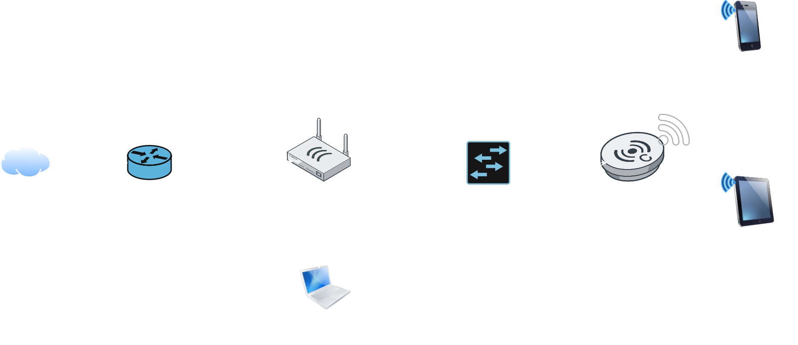

# NetworkAuditor

A cross-platform Python tool that scans your local network, discovers active devices, and displays IP address, MAC address, vendor, and hostname for each host. Runs on macOS and Windows.

---

## Network Topology



---

## What It Does

- Detects the operating system it is running on (macOS or Windows)
- Reads active network interfaces and extracts IP address and subnet mask
- Converts the subnet mask to CIDR notation
- Runs a quiet ping scan using nmap across the detected subnet
- Displays each discovered device with IP, MAC address, vendor, hostname, and status
- On macOS, automatically relaunches with sudo if root is required for ARP scanning

---

## Requirements

- Python 3
- nmap installed on your system
- python-nmap Python library

Install nmap from https://nmap.org/download.html

Install the Python dependency:

```bash
pip install -r requirements.txt
```

---

## Usage

Run from your terminal:

```bash
python3 NetworkAudit.py
```

On macOS the script will automatically request sudo if needed. On Windows run your terminal as Administrator.

---

## Example Output

```
192.168.255.1        00:09:0F:AA:00:01    Fortinet                                 No hostname                    (up / echo-reply)
192.168.255.248      A4:83:E7:12:34:56    Intel Corporate                          No hostname                    (up / echo-reply)
```

---

## Supported Platforms

| Platform | Status  |
|----------|---------|
| macOS    | Working |
| Windows  | Working |